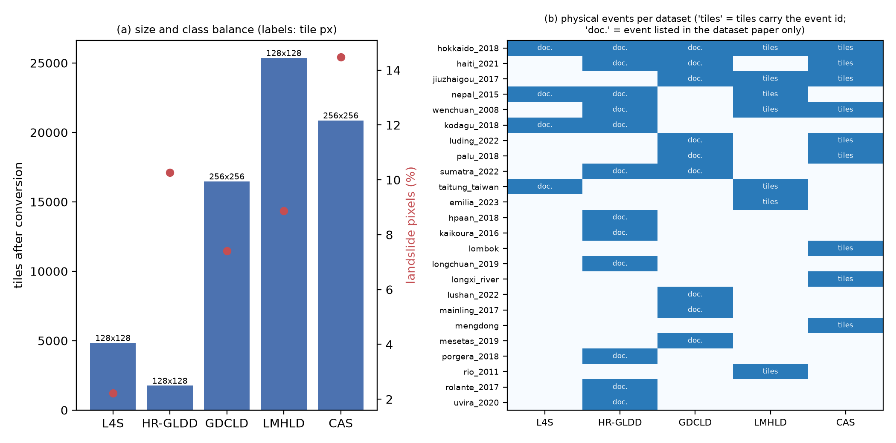
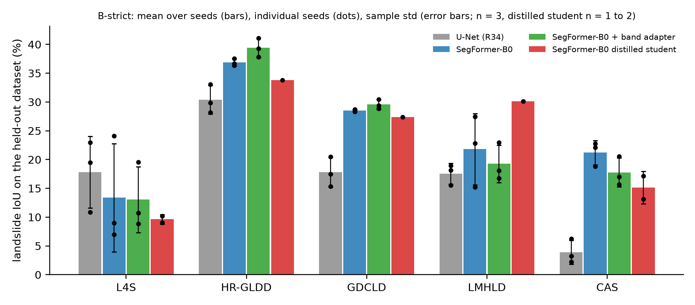
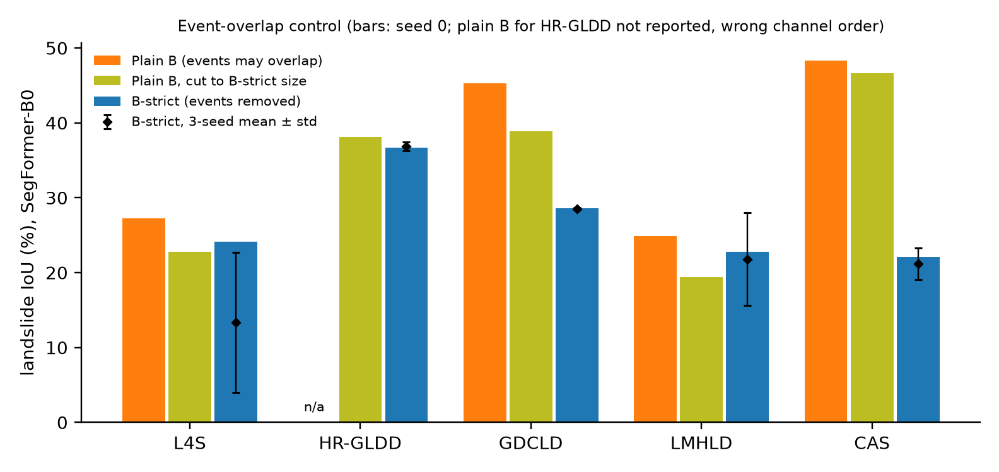
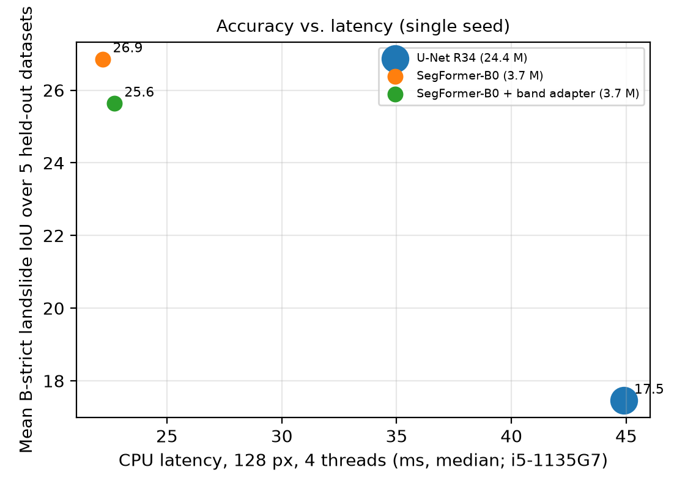
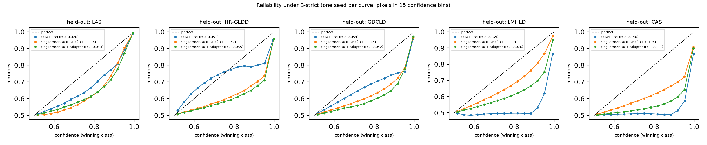
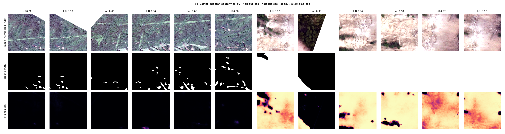

# How far do compact models transfer across landslide datasets? An event-isolated evaluation with calibration and CPU-latency evidence

*Preview rendered from `manuscript.tex` by `scripts/make_preview.py`; the .tex is authoritative. Citation and cross-reference numbers are reconstructed.*

## Abstract

Landslide segmentation models are usually trained and tested inside a single benchmark, often with random tile splits, so published scores do not show whether a model works in a new region.
We convert five public datasets (Landslide4Sense, HR-GLDD, GDCLD, LMHLD and CAS Landslide; 69,305 tiles after conversion) to one format and evaluate leave-one-dataset-out transfer under an *event-isolated* protocol that removes every training tile sharing a documented physical event with the held-out dataset; 10 of the 24 events we document appear in more than one dataset.
Over 3 seeds, a compact SegFormer-B0 (3.7 M parameters) reached a mean landslide IoU of 24.4 ± 2.9 over the five held-out datasets and a ResNet34 U-Net 17.5 ± 2.9, at 22 ms and 45 ms per 128 px tile on a laptop CPU. The ranking is not uniform (the U-Net has the higher mean on Landslide4Sense), and seed-to-seed variation is large on some datasets (standard deviation up to 9.4 IoU points).
A control that keeps overlapping events but matches the training-set size indicates that removing shared events lowers IoU by about 24.6 points on CAS and 10.3 points on GDCLD (single seed), and by less than the seed noise on Landslide4Sense and LMHLD.
A learned band adapter (23.8 ± 1.8) and distillation from a LoRA-adapted SegFormer-B3 teacher (distilled student 22.9, one complete seed) did not improve transfer over the plain RGB model. Models were over-confident on unseen datasets (mean expected calibration error 0.055 ± 0.006 for SegFormer-B0 and 0.087 ± 0.003 for the U-Net).
We also document a channel-order problem in HR-GLDD that, uncorrected, collapses transfer to that dataset.
The evidence is limited to RGB inputs, short training, one compact architecture family, and single-seed controls; these limits and the negative results are reported alongside the findings.

**Keywords:** landslide segmentation; cross-region generalisation; event-isolated evaluation; SegFormer; model calibration; edge inference

## 1. Introduction

Deep learning for landslide identification from satellite and UAV imagery has grown quickly; a recent review of more than 400 studies lists data imbalance, limited generalisation across regions and the complexity of landslide mechanisms among the open challenges [1]. Most published models are, however, trained and tested on tiles cut from the same source. The study that motivated this work, for example, trains and tests each of three datasets separately with random 70/15/15 or 70/30 splits [2]. Tiles taken from the same image, event and sensor are spatially adjacent and radiometrically similar; we argue that a random tile split therefore measures interpolation within a scene more than the ability to map landslides in a new region. We test this argument empirically rather than assume it.

Evaluation on unseen regions and events does exist, but under different protocols and tasks: progressive training on combined inventories applied to new regions [3], Sentinel-1 models trained on 11 earthquake events and applied to unseen events [4], global prediction of earthquake-triggered landslide probability [5], and foundation-model adaptation evaluated on an event-isolated benchmark [6]. Their numbers are not comparable with one another or with in-benchmark scores. Separately, recent work benchmarks parameter-efficient fine-tuning of large models on a single dataset [7], or studies band adaptation of one foundation model [8]. To our knowledge, none of the sources we examined (a literature search in October 2026, not an exhaustive review) evaluates compact RGB segmentation models under one event-isolated leave-one-dataset-out protocol over five public datasets while also reporting calibration and CPU latency.

We ask four questions. **RQ1:** How much does event overlap inflate leave-one-dataset-out scores? **RQ2:** How do a compact transformer (SegFormer-B0) and a ResNet34 CNN compare under event-isolated transfer? **RQ3:** Do a learned band adapter and distillation from a LoRA-adapted larger teacher improve the compact model? **RQ4:** How well calibrated and how fast are these models on a CPU?

**Contributions.**  (i) An event-isolated multi-dataset protocol with an automated leakage report and an event inventory for five public datasets (Section 3). (ii) A measurement of the effect of event overlap, using a size-matched control that separates it from the effect of having less training data (Section 6.3). (iii) A three-seed comparison of SegFormer-B0 and a U-Net, with the cost of each, that shows how much single-seed rankings can mislead (Sections 6.2 and 6.6). (iv) Two negative results, for a band adapter and for distillation from a LoRA teacher, reported with their limits (Sections 6.4 and 6.5). (v) Calibration, failure-case and data-quality findings, including a channel-order problem that changes a result by an order of magnitude (Sections 6.7 and 3.4). We do not claim a new state-of-the-art score, and published numbers are quoted only where we read them in the source and are labelled as such.

## 2. Related work

**Datasets.**  The Landslide4Sense competition released 128 px patches with 14 Sentinel-2 and terrain bands [9]. GDCLD offers 1024 px RGB tiles from nine earthquake events, with separate validation and test events [10]. CAS Landslide combines satellite and UAV imagery from several regions [11], HR-GLDD offers 3 m PlanetScope patches [12], and LMHLD offers patches from five sensors and seven study areas [13]. Sen12Landslides adds Sentinel-1/2 time series [14]; we did not use it because of its size. We found that none of these datasets except LMHLD and CAS exposes an event or region identifier per tile (Section 3).

**Cross-region and cross-event generalisation.**  Prakash et al. [3] train a CNN progressively on combined inventories and report a Matthews correlation coefficient of 0.69 in unseen regions. Nava et al. [4] report F1 up to 82% on two unseen events for Sentinel-1-based models trained on 11 events. Fan et al. [5] predict landslide probability for earthquakes worldwide, which is a related but different task. Chen et al. [15] apply unsupervised domain adaptation with inter-domain translation to landslide segmentation, and GeoPhysAdapter [6] adapts a frozen vision foundation model with terrain, material and rainfall priors on an event-isolated benchmark. General domain-generalisation work cautions that carefully tuned empirical risk minimisation is a strong baseline and that model selection is part of the method [16]; we therefore use plain empirical risk minimisation and report how checkpoints are selected.

**Foundation models and parameter-efficient adaptation.**  Prithvi-EO-2.0 was evaluated on Landslide4Sense against U-Net baselines [17]; a follow-up compares it with SegFormer, SwinV2-B, SatMAE and TerraMind, and studies band adaptation and geographic generalisation [8]. A 2026 benchmark on GDCLD compares CNN, transformer and foundation models with full fine-tuning, LoRA and AdaLoRA, reporting up to 95% fewer trainable parameters at comparable accuracy [7]. A Clay-based hybrid with two-stage LoRA is evaluated on Landslide4Sense [18], and TransLandSeg adapts a vision foundation model with a small fraction of its parameters [19]. These studies use one dataset or one training distribution and do not remove events shared by training and test data.

**Lightweight models and distillation.**  Ge et al. [20] distil a YOLOv5x teacher into a lightweight CenterNet-based landslide detector, and Ni et al. [21] report a lightweight student for InSAR-optical landslide extraction; we know the latter from its abstract only. Both are single-dataset and use different inputs. LoRA [22] and knowledge distillation [23] are the generic techniques we adapt. Calibration is measured with the expected calibration error [24].

## 3. Data and protocols

### 3.1 Datasets and conversion

Table 1 summarises the five datasets after conversion; every value is measured on our converted tiles. GDCLD and CAS were reduced to 256 px (box-average downscaling; masks by majority vote) from 1024 px tiles (GDCLD) and, in the tiles we inspected and in the dataset description, 512 px tiles (CAS); LMHLD tiles of 32 to 224 px were resized to 128 px; Landslide4Sense and HR-GLDD are native 128 px. GDCLD's seven large test images were cut into non-overlapping 1024 px crops (mostly empty crops dropped) and downscaled in the same way. A perfect 256 px predictor would still reach a landslide IoU of 89.5 on these GDCLD test crops (computed by upsampling the downscaled labels; `scripts/downscale_ceiling.py`), so downscaling is not the main limit on our GDCLD scores. Every CAS tile contains a landslide, so false-alarm rates cannot be estimated on CAS.

| Dataset | Source | Tiles | Tile (px) | Bands | Official split | Landslide px (%) | Events/regions | Licence |
|–-|–-|–-|–-|–-|–-|–-|–-|–-|
| L4S | [9] | 4,844 | 128×128 | 14 | 3799/245/800 | 2.2 | not exposed | CC BY 4.0 |
| HR-GLDD | [12] | 1,758 | 128×128 | 4 | 1119/284/355 | 10.3 | not exposed | CC BY 4.0 |
| GDCLD | [10] | 16,473 | 256×256 | 3 | 11162/4459/852 | 7.4 | 4 (test only) | CC BY 4.0 |
| LMHLD | [13] | 25,365 | 128×128 | 4 | 17753/5072/2540 | 8.9 | 7 | CC BY 4.0 |
| CAS | [11] | 20,865 | 256×256 | 3 | none (own region split) | 14.5 | 10 | CC BY-NC 4.0 |

*Datasets after conversion. Landslide pixels are the share of landslide pixels in the converted masks (not the share of samples quoted in some dataset papers). “Events/regions” counts events or regions identifiable from the files shipped; for GDCLD only the test crops carry an event. CAS ships no split; we use a deterministic region-level split.*

### 3.2 Event inventory and event isolation

The same physical event is imaged by several datasets: from the dataset papers and READMEs we document 24 events, of which 10 occur in at least two of the five datasets, 5 in at least three, and 1 event (Hokkaido 2018) in all five (Figure 1; Appendix Table 12). A plain leave-one-dataset-out split can therefore train on the very event it is tested on. Event assignments come from dataset papers and READMEs; some rely on place names and are treated conservatively as the same event when plausible (for example, two CAS sites imaged in the same 2022 campaign in Sichuan are both assigned to the 2022 Luding earthquake). Residual overlap therefore cannot be excluded.

*(a) Tiles and landslide-pixel share per dataset (labels: tile size in pixels). (b) Documented physical events per dataset. “tiles”: tiles carry the event identifier; “doc.”: the event is listed in the dataset paper only. Event membership is partly inferred (Section 3).*

### 3.3 Protocols

**Protocol A (in-dataset)** uses the official split. LMHLD's official split is a random tile split inside each event, so all its events appear in both train and test, and GDCLD's test events are probably also present among its training tiles; protocol A numbers for these two datasets are therefore not event-isolated. **Protocol B (leave-one-dataset-out)** tests on every tile of the held-out dataset and trains and validates on the official train and validation tiles of the other four. **Protocol B-strict** additionally removes every training tile whose documented event also occurs in the held-out dataset (per tile for LMHLD and CAS, which carry event identifiers; the whole dataset for datasets without them). B-strict therefore trains on 5,526 to 25,014 tiles instead of 30,767 to 47,401 for protocol B. **Protocol C** (leave-one-event/region-out inside LMHLD and CAS) was defined and its splits checked for leakage, but was not run (Section 8).

An automated report checks, for every fold, overlapping tile references, groups straddling train and test, byte-identical tiles across train and test, and documented events shared between train and test. All are zero for B, B-strict and C. Protocol A contains one byte-identical near-black no-data crop in GDCLD. Byte hashing cannot detect overlapping neighbouring tiles; this is controlled only by splitting at event or region level.

### 3.4 Data issues found while converting

- **HR-GLDD band order.** The paper describes the bands as red, green, blue and near-infrared [12], but the arrays appear to be in B,G,R,NIR order. The channel statistics are suggestive but weak (Appendix D): the ordering of channel means matches one of two LMHLD PlanetScope scenes of documented order and not the other. The decisive evidence is behavioural: with the original mapping the held-out HR-GLDD fold reached a landslide IoU of 2.6 (SegFormer-B0, seed 0; U-Net 2.2) and with the B,G,R,NIR mapping 36.7 (U-Net 29.9). We tested only these two orderings, and the mapping was changed after the failure on that fold had been observed (Section 5). The order is therefore “very likely” B,G,R,NIR but not documented by the source.

- **LMHLD** is four-band (blue, green, red, near-infrared), not RGB [13]; its Rio de Janeiro arrays carry a fifth channel that the paper does not explain, which we drop (assuming red edge).

- **CAS** documents more images in its README than are shipped in the archive (20,865 in our data); several archives are the same site imaged by different sensors, so we group by physical region.

- The Landslide4Sense Zenodo release includes masks for the test split, which the competition README describes as withheld. The “MS2LandsNet” data source cited by [2] is a re-upload of Landslide4Sense; MS2LandsNet is a network [25].

## 4. Methods

### 4.1 Models and training

We use ResNet34-encoder U-Net [26] and DeepLabV3+ [27] and the MiT-B0 SegFormer [28] (3.7 M parameters) from the `segmentation_models_pytorch` library [29], with ImageNet-pretrained encoders. Cross-dataset runs use RGB (the only input all datasets provide), random 128 px crops at native scale (so that 128 px and 256 px datasets mix without rescaling), flips and 90° rotations, 10 epochs, batch size 32, AdamW, cosine learning-rate decay, mixed precision and a loss of cross-entropy plus soft Dice (all settings: Appendix Table 13). The weights of the epoch with the best validation landslide IoU are used once on the test set. In cross-dataset runs the per-epoch validation set is a random subset of at most 3,000 tiles of the training datasets' validation splits; test data are never subsampled. In-dataset L4S models read all 14 native bands. No per-dataset hyper-parameter tuning was done; the settings were fixed in advance for each protocol family, apart from the two decisions disclosed in Section 5.

### 4.2 Band adapter

To let one network accept different sensors, a 1×1 convolution maps an 11-slot channel bank (R, G, B, NIR, red edge, SWIR1, SWIR2, slope, DEM, VV, VH) to three channels in front of a pretrained RGB network. It is initialised as the identity on R, G, B and zero elsewhere, so training starts exactly at the RGB model. Slots missing in a dataset are masked, and during training the non-RGB slots are randomly dropped (per sample with probability 0.3, per slot 0.2) so the network does not depend on bands that a target sensor lacks. Landslide4Sense fills 9 of the 11 slots.

### 4.3 LoRA teacher and distillation

A SegFormer-B3 teacher is adapted with LoRA [22] (rank 8 on the attention and MLP projections of the frozen encoder; 1.61 M of 45.7 M parameters, 3.5%, are trained, including the decoder) for 10 epochs in each fold. It is then frozen, and the SegFormer-B0 student minimises (1-α) (CE+Dice) + α T^2 KL(p_T^teacher ‖ p_T^student) with α=0.5 and T=2.0 [23]. Neither α, T nor the LoRA rank was tuned.

### 4.4 Metrics and statistics

We report landslide IoU, mIoU (mean of landslide and background IoU), F1 (landslide class), precision and recall at probability threshold 0.5, PR-AUC (histogram estimate over 2,000 probability bins) and the expected calibration error (ECE) of the winning class with 15 confidence bins [24], all accumulated over every test pixel of a held-out dataset. Means are unweighted over datasets. “Mean ± std” is the mean and sample standard deviation over seeds; the five-dataset mean is computed per seed and then summarised. With 3 seeds a standard deviation is itself very uncertain, and with five folds the smallest possible two-sided Wilcoxon p is 0.0625, so we report differences and sign counts and make no significance claims.

### 4.5 Efficiency measurement

Latency was measured on a laptop CPU (Intel Core i5-1135G7, 4 threads, batch 1, fp32, median of at least 15 runs after 5 warm-ups, random weights, `torch.inference_mode`). GFLOPs count multiply-adds with `torch.utils.flop_counter`. These are laptop-CPU figures and not measurements on an embedded accelerator.

### 4.6 Evidence conventions and integrity measures

Four kinds of statements appear below: (E1) values we measured, each generated from a stored result file; (E2) values quoted from other papers, labelled as such and read through a page-retrieval tool rather than from original tables, listed in one file with their source; (E3) values derived by us from E1 or E2; and (E4) interpretations or hypotheses, which we mark with “we interpret”, “may” or “untested”. Every number in the text and tables is produced by scripts from the run files, and unit tests cover the metrics, splits, band adapter and LoRA implementation. Training was run on a single Tesla T4 per job; GPU non-determinism means runs are not bit-reproducible, and the version of the segmentation library on the GPU runs was not recorded.

## 5. Experimental design and disclosures

Each cross-dataset configuration was run with seeds 0, 1 and 2, except the distilled student (seed 0 on all folds, a second seed on two folds) and the controls and teacher (seed 0). In-dataset baselines are single-seed. Two decisions were informed by test results, and we disclose them: (1) after observing the failure on the held-out HR-GLDD fold we examined the channel order and changed the mapping (Section 3.4); (2) we trained SegFormer-B0 on GDCLD for 60 instead of 20 epochs to check for under-training, compared the test results, and kept 20 epochs, which were also not worse on test. Otherwise no model was selected using test data.

## 6. Results

### 6.1 In-dataset baselines

Table 2 gives protocol A results (single seed). On Landslide4Sense with all 14 bands the U-Net reaches a landslide IoU of 48.0 and SegFormer-B0 46.7; restricted to RGB they fall to 37.9 and 39.2, and the band adapter on 9 of 11 slots gives 42.2. On GDCLD, SegFormer-B0 is best (mIoU 70.1, IoU 40.9; U-Net 38.7) with 3.7 M parameters and 1.75 GFLOPs at 256 px, against 24.4 M and 7.82 for the U-Net; training SegFormer-B0 for 60 epochs did not help on test (40.0).

| Dataset | Input | Model | Params (M) | GFLOPs | mIoU | IoU | F1 | Prec. | Rec. | PR-AUC | ECE |
|–-|–-|–-|–-|–-|–-|–-|–-|–-|–-|–-|–-|
| L4S | 14 bands | U-Net R34 | 24.5 | 2.1 | 73.3 | 48.0 | 64.9 | 62.9 | 67.1 | 0.673 | 0.010 |
| L4S | 14 bands | DeepLabV3+ R34 | 22.5 | 2.1 | 71.9 | 45.3 | 62.3 | 58.3 | 66.9 | 0.636 | 0.011 |
| L4S | 14 bands | SegFormer-B0 | 3.7 | 0.4 | 72.6 | 46.7 | 63.7 | 57.3 | 71.6 | 0.657 | 0.010 |
| L4S | RGB | U-Net R34 | 24.4 | 2.0 | 68.2 | 37.9 | 54.9 | 71.7 | 44.5 | 0.572 | 0.011 |
| L4S | RGB | SegFormer-B0 | 3.7 | 0.4 | 68.8 | 39.2 | 56.3 | 63.1 | 50.8 | 0.556 | 0.011 |
| L4S | bank (9 of 11 slots) | SegFormer-B0 + adapter | 3.7 | 0.4 | 70.2 | 42.2 | 59.4 | 51.5 | 70.2 | 0.604 | 0.011 |
| GDCLD | RGB | U-Net R34 | 24.4 | 7.8 | 69.0 | 38.7 | 55.8 | 68.5 | 47.1 | 0.604 | 0.005 |
| GDCLD | RGB | DeepLabV3+ R34 | 22.4 | 7.9 | 67.0 | 34.8 | 51.7 | 63.2 | 43.7 | 0.562 | 0.005 |
| GDCLD | RGB | SegFormer-B0 | 3.7 | 1.7 | 70.1 | 40.9 | 58.1 | 72.6 | 48.4 | 0.654 | 0.004 |
| GDCLD | RGB | SegFormer-B0, 60 epochs | 3.7 | 1.7 | 69.6 | 40.0 | 57.1 | 61.2 | 53.6 | 0.529 | 0.005 |

*In-dataset results (protocol A, official test sets, single seed). Landslide4Sense test masks are those shipped in the Zenodo release. All numbers measured by us.*

**Context from the literature (E2).**  Table 3 lists values reported by others. On Landslide4Sense the cited papers report U-Net mIoU/F1 of 70.4/59.7 [17] and 70.44/59.66 [8]; our U-Net reaches 73.3/64.9. We do not read this as an improvement: the inputs (all 14 bands against six bands in [17]), encoder, loss and checkpoint selection differ, and we did not re-run their pipelines.

For GDCLD our SegFormer-B0 reaches a test mIoU of 70.1. The GDCLD paper reports for SegFormer a mIoU of 85.06 on its *validation* set but 72.84 on its independent *test* set of four events [10]; our figure is −2.7 points from the latter. That paper does not state how mIoU or F1 are averaged over classes. Under the assumption that its F1 is a two-class average, the corresponding quantity for our model, derived from our stored IoU values, is 78.9 against their 81.88 (our landslide-class F1 alone is 58.1); we cannot confirm their averaging, input size or model variant, and our model is smaller, trained for fewer epochs, and evaluated on 256 px downscaled crops. We therefore regard our GDCLD result as broadly consistent with the cited test result; comparing it with the cited *validation* figure would mix splits that differ by 12.22 points in that paper alone.

| Source | Dataset / split | Model | Input | mIoU | F1 |
|–-|–-|–-|–-|–-|–-|
| [8] | L4S test | U-Net | see source | 70.44 | 59.66 |
| [8] | L4S test | SegFormer | see source | 69.89 | 59.12 |
| [8] | L4S test | Prithvi-EO-2.0-300M | see source | 71.30 | 60.70 |
| [17] | L4S test | U-Net (ResNet50) | 6 bands | 70.4 | 59.7 |
| [10] | GDCLD validation | SegFormer | RGB 1024 px | 85.06 | 91.52 |
| [10] | GDCLD validation | U-Net | RGB 1024 px | 71.07 | 79.54 |
| [10] | GDCLD test (4 events) | SegFormer | RGB 1024 px | 72.84 | 81.88 |

*Values reported by other papers, shown as context only (E2). Read through a page-retrieval tool; table images were not inspected, so every value must be checked against the original. Inputs, splits, models and metric definitions differ from ours.*

**Validation overstates test.**  In our GDCLD runs the best validation landslide IoU exceeds the test IoU by 29.2 points (SegFormer-B0; 30.8 for the U-Net). The cited GDCLD paper shows a similar pattern in its own numbers (12.22 mIoU points between validation and test). Both are consistent with validation tiles sharing events with training tiles; we cannot prove this, because GDCLD's training and validation tiles carry no event identifier. The test crops also contain a much smaller share of landslide pixels than the training and validation tiles, which lowers IoU for the same per-pixel error.

### 6.2 Cross-dataset transfer under B-strict

Table 4 and Figure 2 report landslide IoU on each held-out dataset (mean ± std over 3 seeds). SegFormer-B0 reaches 24.4 ± 2.9 averaged over the five datasets and the U-Net 17.5 ± 2.9. SegFormer-B0 is ahead on 4 of 5 datasets (differences of seed means: HR-GLDD +6.5, GDCLD +10.7, LMHLD +4.3, CAS +17.3; mean +6.9) and behind on Landslide4Sense (−4.4), where both models vary strongly between seeds (std 9.4 and 6.2). The gap on CAS is the largest: the U-Net gets 3.9 ± 2.1 against 21.2 ± 2.1. Seed 0 of SegFormer-B0 reached 24.1 on Landslide4Sense whereas the three-seed mean is 13.4; a single-seed ranking on that fold would have been misleading. Per-seed values are in Appendix Table 10 and further metrics in Appendix Tables 8 and 9. We interpret the difference between the two architectures as suggestive evidence for SegFormer-B0 on average, not as a significant effect.

| Method | L4S | HR-GLDD | GDCLD | LMHLD | CAS | Mean |
|–-|–-|–-|–-|–-|–-|–-|
| U-Net (ResNet34) | 17.8±6.2 | 30.4±2.5 | 17.8±2.6 | 17.5±1.8 | 3.9±2.1 | 17.5±2.9 |
| SegFormer-B0 | 13.4±9.4 | 36.9±0.6 | 28.5±0.2 | 21.8±6.2 | 21.2±2.1 | 24.4±2.9 |
| SegFormer-B0 + band adapter | 13.0±5.7 | 39.4±1.7 | 29.6±0.8 | 19.3±3.2 | 17.8±2.5 | 23.8±1.8 |
| SegFormer-B0 distilled student | 9.6±0.8‡ | 33.8† | 27.4† | 30.1† | 15.1±2.8‡ | 22.9† |

*Landslide IoU (%) on the held-out dataset under B-strict, mean ± sample std over seeds. † single seed; ‡ two seeds. The last column is the mean over the five datasets, computed per seed. The distilled student has a complete five-dataset set only for seed 0.*

*B-strict landslide IoU per held-out dataset: means (bars), individual seeds (dots) and sample standard deviation (error bars).*

### 6.3 Effect of event overlap

Plain leave-one-dataset-out (events may overlap) gives SegFormer-B0 a seed-0 IoU of 48.3 on CAS and 45.3 on GDCLD, against 22.1 and 28.6 under B-strict (Table 5, Figure 3). Because B-strict also trains on fewer tiles, we repeated plain B with the training set randomly cut to the B-strict size. On CAS this size-matched run stays at 46.7, so the drop of 24.6 points is attributable to the removal of shared events and only 1.6 points to data volume. On GDCLD the 16.7-point drop splits into 6.4 points for data volume and 10.3 for shared events. On Landslide4Sense and LMHLD the differences between the size-matched and B-strict runs (−1.3 and −3.4) are smaller than the B-strict seed standard deviations (9.4 and 6.2), so these data show no detectable effect, which is not the same as no effect. The plain-B and size-matched runs are single seeds; for CAS and GDCLD the effects are far larger than the B-strict seed standard deviations (2.1 and 0.2), but a multi-seed repeat would be needed to quantify them. The plain-B HR-GLDD fold was made with the wrong channel order and is not reported.

| Held-out | Plain B | Plain B, size-matched | B-strict | Difference attributable to |  |
|–-|–-|–-|–-|–-|–-|
|  | (seed 0) | (seed 0) | (seed 0) | training-set size | shared events |
| L4S | 27.3 | 22.8 | 24.1 | 4.5 | −1.3 |
| HR-GLDD | n/a | 38.1 | 36.7 | n/a | 1.4 |
| GDCLD | 45.3 | 38.9 | 28.6 | 6.4 | 10.3 |
| LMHLD | 24.9 | 19.4 | 22.8 | 5.5 | −3.4 |
| CAS | 48.3 | 46.7 | 22.1 | 1.6 | 24.6 |

*Event-overlap control, SegFormer-B0, landslide IoU (%), seed 0. “Difference attributable to” is plain B minus size-matched (training-set size) and size-matched minus B-strict (shared events).*

*Event-overlap control for SegFormer-B0 (bars: seed 0; diamonds: B-strict mean ± std over three seeds).*

### 6.4 Band adapter

Under B-strict the band adapter gives 13.0 ± 5.7 (L4S), 39.4 ± 1.7 (HR-GLDD), 29.6 ± 0.8 (GDCLD), 19.3 ± 3.2 (LMHLD) and 17.8 ± 2.5 (CAS), a five-dataset mean of 23.8 ± 1.8 against 24.4 ± 2.9 for RGB-only SegFormer-B0. Differences of seed means are +2.5 (HR-GLDD), +1.0 (GDCLD), −0.3 (L4S), −2.5 (LMHLD) and −3.5 (CAS), positive on 2 of 5 datasets, with a mean of −0.5. There is no detectable cross-dataset benefit in our setting. In-dataset on Landslide4Sense, where the extra bands are present at test time, the adapter does help (42.2 against 39.2 for RGB only, single seed). The adapter adds essentially no computation (0.43 against 0.42 GFLOPs) and no measurable latency (23 against 22 ms), and lets one model take RGB, four-band and 14-band inputs. We conjecture, without having tested it, that most training sensors in a B-strict fold provide only RGB, so the extra bands are rarely informative during training.

### 6.5 LoRA teacher and distillation

The SegFormer-B3 teacher (45.7 M parameters; 1.61 M trained) reaches (seed 0) a mean landslide IoU of 30.2 over the five datasets, +3.3 points relative to seed 0 of the RGB SegFormer-B0 (26.9); it is 12.3 times larger and 3.9 times slower on the CPU. The distilled student did not beat the undistilled student (Table 6): its seed-0 five-dataset mean is 22.9 against 26.9, and it was worse on four of five datasets (differences of seed means: L4S −3.7, HR-GLDD −3.1, GDCLD −1.1, CAS −6.1) and better on LMHLD (+8.3, a single seed there). The drops on L4S and CAS reproduced with a second seed (L4S 9.6 ± 0.8, CAS 15.1 ± 2.8), so they are not one-off failures, although the undistilled L4S baseline is itself very noisy (13.4 ± 9.4). This is a negative result for this configuration: we did not tune α, T or the LoRA rank, tried one teacher, and did not run rank or distillation-type ablations.

| Held-out | Teacher B3+LoRA (seed 0) | Student, KD | Student, no KD (seed 0) | Student, no KD (mean of seeds) |
|–-|–-|–-|–-|–-|
| L4S | 22.7 | 9.6±0.8‡ | 24.1 | 13.4±9.4 |
| HR-GLDD | 38.6 | 33.8† | 36.7 | 36.9±0.6 |
| GDCLD | 33.3 | 27.4† | 28.6 | 28.5±0.2 |
| LMHLD | 30.1 | 30.1† | 22.8 | 21.8±6.2 |
| CAS | 26.3 | 15.1±2.8‡ | 22.1 | 21.2±2.1 |
| Mean | 30.2 | 22.9† | 26.9 | 24.4±2.9 |

*Teacher and distilled student, B-strict landslide IoU (%). † single seed; ‡ two seeds. The teacher was trained once per fold (seed 0).*

### 6.6 Efficiency

Table 7 and Figure 4 give parameters, GFLOPs and CPU latency. At 128 px SegFormer-B0 takes 22 ms with four threads (3.7 M parameters, 0.42 GFLOPs, 15 MB of fp32 weights) against 45 ms for the U-Net (24.4 M, 1.96 GFLOPs), a factor of 2.0, and is on average more accurate under B-strict. Median training time per B-strict fold was 382 s for SegFormer-B0 and 496 s for the U-Net on a T4 (a distilled-student fold took 839 s plus 1329 s for the teacher). Single-thread timings are noisier. On the accuracy axis of Figure 4, the adapter and the distilled student sit at the same latency as SegFormer-B0 without an accuracy gain.

| Model | Params (M) | Weights fp32 (MB) | GFLOPs, 128 px | 128 px, 1 thread (ms) | 128 px, 4 threads (ms) | 256 px, 4 threads (ms) |
|–-|–-|–-|–-|–-|–-|–-|
| U-Net R34 | 24.4 | 98 | 1.96 | 92 | 45 | 141 |
| DeepLabV3+ R34 | 22.4 | 90 | 1.97 | 90 | 53 | 139 |
| SegFormer-B0 | 3.7 | 15 | 0.42 | 28 | 22 | 78 |
| SegFormer-B0 + band adapter | 3.7 | 15 | 0.43 | 41 | 23 | 88 |
| SegFormer-B3 (teacher) | 44.6 | 178 | 2.26 | 176 | 88 | 289 |

*Parameters and CPU latency (median; Intel Core i5-1135G7, batch 1, fp32). The teacher's parameter count is for the base model; with LoRA it is 45.7 M.*

*Mean B-strict landslide IoU against CPU latency (128 px, 4 threads); error bars are the std over seeds where more than one seed is available (the distilled student has one complete seed).*

### 6.7 Calibration

Pixel-level ECE is low in-dataset (0.010 for the L4S U-Net; 0.004 for the GDCLD SegFormer-B0) but higher on unseen datasets: five-dataset means are 0.055 ± 0.006 for SegFormer-B0 and 0.087 ± 0.003 for the U-Net, with the largest values on CAS (0.108 ± 0.005 and 0.142 ± 0.003) and, for the U-Net, on LMHLD (0.168 ± 0.008). Reliability curves (Figure 5) lie below the diagonal for every method: confident predictions are right less often than their confidence implies. The U-Net's confident predictions on LMHLD and CAS are barely better than chance. ECE is computed over all pixels and is dominated by background, which limits its meaning for rare-class segmentation.

*Reliability diagrams under B-strict (seed 1; 15 confidence bins; accuracy of the winning class).*

### 6.8 Failure analysis

Failures are local rather than uniform (Appendix Table 11; size-matched SegFormer-B0 runs, seed 0): on CAS, Palu reaches 1.9 and Lombok 9.6 against 55.5 for Jiuzhai valley; on GDCLD, Mesetas 2.2 and Lushan 13.2 against 31.8 for Palu; on LMHLD, Wenchuan (IKONOS, 0.8 m) 4.5 against 19.1 to 32.7 for the other six events. Figure 6 shows the two typical outcomes on held-out CAS (adapter model, seed 1): tiles whose landslides cover 1.0 to 5.2% of the area and are missed entirely (IoU 0.00), and near-whole-tile landslides in 0.2 m UAV imagery of Jiuzhai valley that are easy (IoU 0.93 to 0.98). Many tiles tie at IoU 0.00 and our export breaks ties by tile index, so the six “worst” tiles all come from one region (Hokkaido Iburi-Tobu, a 3 m satellite subset); they illustrate a failure mode and are not a ranking of the worst cases.

*Left six: lowest tile-IoU examples; right six: highest, among tiles with at least 1% landslide pixels (held-out CAS, band-adapter model, seed 1). Rows: normalised RGB, ground truth, predicted landslide probability.*

## 7. Discussion

**What the evidence supports.**  (1) Scores obtained without removing shared events can substantially overstate cross-dataset performance on some datasets: the effect is large for CAS and GDCLD in our single-seed control and not detectable on the other three. (2) Under event-isolated transfer a compact SegFormer-B0 is, on average over datasets and seeds, at least as accurate as a ResNet34 U-Net with several times more parameters, at half the CPU latency, although the ranking varies by dataset and the difference is not shown to be significant. (3) Neither the band adapter nor distillation from a larger LoRA teacher improved the compact model in our configuration. (4) All models were over-confident on unseen datasets. (5) A single misdocumented channel order can change a transfer result by an order of magnitude, and several dataset documents are inconsistent with the files.

**What it does not support.**  We did not show that SegFormer-style models are intrinsically better at transfer: one family was tried, with short training, RGB input and no tuning. We did not show that distillation or band adaptation cannot work: we tested one configuration each. We cannot attribute the validation–test gap on GDCLD to event overlap, because event identifiers are missing for its training and validation tiles. Event overlap is quantified only for single-seed controls, and event membership is partly inferred.

**Implications for benchmark design (recommendations, E4).**  Report which physical events a test set shares with the training data; prefer a held-out dataset or event over a held-out tile; report several seeds, since a single seed misranked methods on one fold in our data; report calibration and latency, not only overlap metrics; and publish tile-level event or region identifiers with datasets so that isolation can be checked. Event identifiers were available only for two of the five datasets.

**Why the adapter and distillation may not have helped (hypotheses, untested).**  For the adapter, the lack of sensors with extra bands in the training pool of a B-strict fold; for distillation, a teacher whose own transfer is only moderately better than the student, a short schedule, and untuned α and T. These would need dedicated experiments.

## 8. Limitations

- **Seeds and statistics.** The headline B-strict comparisons use 3 seeds; the teacher, the distilled student, the event-overlap control, per-region analysis and in-dataset baselines are single- or two-seed. Seed variation is large on some folds, and five folds do not allow a significance test at the 5% level.

- **Scope of models and inputs.** One compact transformer and two CNNs, RGB (or the adapter's bands), 128 px crops and 10 epochs; no foundation models (excluded by the compute budget), no longer training, no tuning. GDCLD was downscaled by 4 and CAS by about 2 (from the 512 px tiles we inspected), losing detail visible at 0.2 to 1 m resolution in the UAV subsets.

- **Protocol.** Event assignments are partly inferred from place names, so residual overlap cannot be excluded; L4S, HR-GLDD and the GDCLD training and validation tiles carry no event identifiers, so those datasets can only be held out whole; protocol C was not run.

- **Data.** The HR-GLDD band order and the fifth LMHLD Rio channel are inferred. CAS has no negative tiles, so false-alarm statistics are unavailable. LMHLD and GDCLD protocol-A splits are not event-isolated.

- **Metrics.** ECE is pixel-level and dominated by background; PR-AUC is a histogram estimate; F1 is for the landslide class.

- **Hardware.** CPU latency on one laptop; no embedded accelerator, no energy measurement.

- **Test-informed decisions.** The HR-GLDD channel mapping and the 60-epoch GDCLD check used test results (Section 5).

- **Literature.** Several related works are known from abstracts only; quoted external numbers were read via a retrieval tool and must be re-checked against the originals; the novelty statement rests on a limited search.

- **Reproducibility.** Runs are not bit-reproducible on GPU, and the library version on the GPU runs was not recorded.

## 9. Conclusions

Under an event-isolated leave-one-dataset-out protocol over five public datasets, a compact SegFormer-B0 transferred, on average, at least as well as a larger U-Net at half the CPU latency, but absolute transfer accuracy was low (mean landslide IoU 24.4), models were over-confident, and neither a band adapter nor distillation from a LoRA teacher helped. Removing shared events lowered scores markedly on two datasets in a single-seed control. The main practical message is methodological: report event overlap, use several seeds, and check the documentation of channel order and splits before drawing conclusions. We release the code, splits, leakage report and per-run results so that these checks can be repeated.

## Data and code availability

Code, splits, the leakage report, per-run result files, tables and figures are in a public repository (https://github.com/Edith-Stark06/landslide-cross-region). The datasets are available from their original sources and are not redistributed (Landslide4Sense, HR-GLDD, GDCLD, LMHLD and CAS Landslide are on Zenodo: `10.5281/zenodo.10463239`, `7189381`, `13612636`, `17258777`, `10294997`); CAS is licensed CC BY-NC 4.0, the others CC BY 4.0 according to their Zenodo records. Trained model weights were not saved or released.

## Declarations

**[TO DO: Funding, competing interests, author contributions (CRediT), acknowledgements and ethics statements to be completed by the authors.]** **[TO DO: AI-assistance disclosure to be confirmed by the authors per the target journal's policy: the analysis code, the figures and the manuscript draft were prepared with the assistance of a generative AI system (Claude, Anthropic); all numbers are generated from stored run files, and the authors remain responsible for the content.]** Compute: free-tier GPU sessions (Tesla T4) on Kaggle and one laptop CPU.

## References

[1] Jiang, P., Ma, Z., Mei, G. (2026). Review article: deep learning for potential landslide identification: data, models, applications, challenges, and opportunities. *Nat. Hazards Earth Syst. Sci.*, 26, 487–529. doi:10.5194/nhess-26-487-2026.
[2] Srivats, R., Johnson, D. R., Logeswari, G., Saimirra, R., Siddiqui, M., Sharma, A. (2026). A multi-modal deep learning framework with GAN-based fusion for enhanced landslide detection. *PLoS ONE*. doi:10.1371/journal.pone.0347324.
[3] Prakash, N., Manconi, A., Loew, S. (2021). A new strategy to map landslides with a generalized convolutional neural network. *Sci. Rep.*, doi:10.1038/s41598-021-89015-8.
[4] Nava, L., Mondini, A., Bhuyan, K., Fang, C., Monserrat, O., Novellino, A., Catani, F. (2026). Sentinel-1 SAR-based globally distributed co-seismic landslide detection by deep neural networks. *Geosci. Model Dev.*, 19, 167–185. doi:10.5194/gmd-19-167-2026.
[5] Fan, X., Wang, X., Fang, C., Jansen, J. D., Dai, L., Tanyas, H., Zang, N., Tang, R., Xu, Q., Huang, R. (2025). Deep learning can predict global earthquake-triggered landslides. *Natl. Sci. Rev.*, 12(7), nwaf179. doi:10.1093/nsr/nwaf179.
[6] Liu, Z., Kwan, M.-P., Wu, J., Li, H. (2026). GeoPhysAdapter: scale-matched geophysical adaptation for cross-domain landslide mapping with vision foundation models. arXiv:2608.09325.
[7] Kowsher, M., Zhan, W., Chen, C. (2026). A benchmark study of segmentation models and adaptation strategies for landslide detection from satellite imagery. arXiv:2604.16663.
[8] Li, W., Wang, S., Lee, H., Lu, C., Roy, S., Ramachandran, R., Hsu, C.-Y. (2025). Landslide hazard mapping with geospatial foundation models: geographical generalizability, data scarcity, and band adaptability. arXiv:2511.04474.
[9] Ghorbanzadeh, O., et al. (2022). The outcome of the 2022 Landslide4Sense competition: advanced landslide detection from multisource satellite imagery. *IEEE J. Sel. Topics Appl. Earth Obs. Remote Sens.*, 15, 9927–9942. doi:10.1109/JSTARS.2022.3220845. Data: doi:10.5281/zenodo.10463239.
[10] Fang, C., Fan, X., Wang, X., Nava, L., Zhong, H., Dong, X., Qi, J., Catani, F. (2024). A globally distributed dataset of coseismic landslide mapping via multi-source high-resolution remote sensing images. *Earth Syst. Sci. Data*, 16, 4817–4842. doi:10.5194/essd-16-4817-2024.
[11] Xu, Y., Ouyang, C., Xu, Q., Wang, D., Zhao, B., Luo, Y. (2024). CAS Landslide Dataset: a large-scale and multisensor dataset for deep learning-based landslide detection. *Sci. Data*, 11, 12. doi:10.1038/s41597-023-02847-z.
[12] Meena, S. R., Nava, L., Bhuyan, K., Puliero, S., Soares, L. P., Dias, H. C., Floris, M., Catani, F. (2023). HR-GLDD: a globally distributed dataset using generalized deep learning (DL) for rapid landslide mapping on high-resolution (HR) satellite imagery. *Earth Syst. Sci. Data*, 15(7), 3283–3298. doi:10.5194/essd-15-3283-2023.
[13] Liu, G., Wang, Y., Chen, X., Du, B., Li, P., Wu, Y., Fang, Z. (2025). LMHLD: a large-scale multi-source high-resolution landslide dataset for landslide detection based on deep learning. arXiv:2502.19866.
[14] H\"ohn, P., Heidler, K., Behling, R., Zhu, X. X. (2025). A spatio-temporal dataset for satellite-based landslide detection. *Sci. Data*, 12, 1772. doi:10.1038/s41597-025-06167-2.
[15] Chen, W., Chen, Z., Song, D., He, H., Li, H., Zhu, Y. (2024). Landslide detection using the unsupervised domain-adaptive image segmentation method. *Land*, 13(7), 928. doi:10.3390/land13070928.
[16] Gulrajani, I., Lopez-Paz, D. (2021). In search of lost domain generalization. In *Proc. ICLR*. arXiv:2007.01434.
[17] Szwarcman, D., Roy, S., Fraccaro, P., et al. (2024). Prithvi-EO-2.0: a versatile multi-temporal foundation model for Earth observation applications. arXiv:2412.02732 (v3, 2026).
[18] Vu, H. B. (2026). Clay-CNN hybrids: leveraging geospatial foundation models as auxiliary context for landslide detection. arXiv:2606.14081.
[19] Hou, C., Yu, J., Ge, D., Yang, L., Xi, L., Pang, Y., Wen, Y. (2024). TransLandSeg: a transfer learning approach for landslide semantic segmentation based on vision foundation model. arXiv:2403.10127.
[20] Ge, X., Zhao, Q., Wang, B., Chen, M. (2023). Lightweight landslide detection network for emergency scenarios. *Remote Sens.*, 15(4), 1085. doi:10.3390/rs15041085.
[21] Ni, Z., Hu, L., Wang, H., Li, F., Tang, M., Ma, G., Sui, H. (2026). DIGSFNet: deformation-integrity-guided symmetric fusion network for high-risk landslide extraction from multi-source remote sensing images. *Remote Sens.*, 18(16), 2692. doi:10.3390/rs18162692.
[22] Hu, E. J., Shen, Y., Wallis, P., et al. (2022). LoRA: low-rank adaptation of large language models. In *Proc. ICLR*. arXiv:2106.09685.
[23] Hinton, G., Vinyals, O., Dean, J. (2015). Distilling the knowledge in a neural network. arXiv:1503.02531.
[24] Guo, C., Pleiss, G., Sun, Y., Weinberger, K. Q. (2017). On calibration of modern neural networks. In *Proc. ICML*, PMLR 70, 1321–1330.
[25] Lu, W., Hu, Y., Shao, W., Wang, H., Zhang, Z., Wang, M. (2024). A multiscale feature fusion enhanced CNN with the multiscale channel attention mechanism for efficient landslide detection (MS2LandsNet) using medium-resolution remote sensing data. *Int. J. Digit. Earth*, 17(1). doi:10.1080/17538947.2023.2300731.
[26] Ronneberger, O., Fischer, P., Brox, T. (2015). U-Net: convolutional networks for biomedical image segmentation. arXiv:1505.04597.
[27] Chen, L.-C., Zhu, Y., Papandreou, G., Schroff, F., Adam, H. (2018). Encoder-decoder with atrous separable convolution for semantic image segmentation. In *Proc. ECCV*, 801–818. doi:10.1007/978-3-030-01234-2_49.
[28] Xie, E., Wang, W., Yu, Z., Anandkumar, A., Alvarez, J. M., Luo, P. (2021). SegFormer: simple and efficient design for semantic segmentation with transformers. arXiv:2105.15203.
[29] Iakubovskii, P. Segmentation Models PyTorch (software), version 0.5.0 used for local profiling; MIT licence. https://github.com/qubvel-org/segmentation_models.pytorch.

## Appendices

## A. Additional results

| Method | L4S | HR-GLDD | GDCLD | LMHLD | CAS | Mean |
|–-|–-|–-|–-|–-|–-|–-|
| U-Net (ResNet34) | 29.9±9.2 | 46.6±2.9 | 30.2±3.7 | 29.8±2.6 | 7.5±3.8 | 28.8±4.1 |
| SegFormer-B0 | 22.8±14.0 | 53.9±0.7 | 44.4±0.2 | 35.5±8.4 | 35.0±2.9 | 38.3±4.2 |
| SegFormer-B0 + band adapter | 22.8±8.7 | 56.5±1.7 | 45.6±1.0 | 32.2±4.5 | 30.1±3.6 | 37.5±2.6 |
| SegFormer-B0 distilled student | 17.6±1.4‡ | 50.5† | 43.0† | 46.3† | 26.2±4.3‡ | 36.3† |

*B-strict F1 (%) of the landslide class, mean ± std over seeds († one seed, ‡ two).*

| Method | L4S | HR-GLDD | GDCLD | LMHLD | CAS | Mean |
|–-|–-|–-|–-|–-|–-|–-|
| U-Net (ResNet34) | 0.016±0.009 | 0.058±0.006 | 0.052±0.003 | 0.168±0.008 | 0.142±0.003 | 0.087±0.003 |
| SegFormer-B0 | 0.026±0.022 | 0.055±0.002 | 0.044±0.001 | 0.044±0.007 | 0.108±0.005 | 0.055±0.006 |
| SegFormer-B0 + band adapter | 0.036±0.029 | 0.051±0.003 | 0.041±0.002 | 0.058±0.016 | 0.112±0.002 | 0.060±0.009 |
| SegFormer-B0 distilled student | 0.034±0.019‡ | 0.056† | 0.041† | 0.027† | 0.120±0.001‡ | 0.053† |

*B-strict expected calibration error (pixel-level, 15 bins), mean ± std over seeds († one seed, ‡ two).*

| Method | Held-out | Seed 0 | Seed 1 | Seed 2 |
|–-|–-|–-|–-|–-|
| U-Net (ResNet34) | L4S | 19.5 | 10.9 | 23.0 |
| U-Net (ResNet34) | HR-GLDD | 29.9 | 28.2 | 33.1 |
| U-Net (ResNet34) | GDCLD | 17.5 | 15.4 | 20.5 |
| U-Net (ResNet34) | LMHLD | 18.2 | 15.5 | 19.0 |
| U-Net (ResNet34) | CAS | 2.3 | 3.2 | 6.2 |
| SegFormer-B0 | L4S | 24.1 | 9.0 | 7.0 |
| SegFormer-B0 | HR-GLDD | 36.7 | 37.6 | 36.3 |
| SegFormer-B0 | GDCLD | 28.6 | 28.7 | 28.3 |
| SegFormer-B0 | LMHLD | 22.8 | 27.4 | 15.2 |
| SegFormer-B0 | CAS | 22.1 | 22.8 | 18.8 |
| SegFormer-B0 + band adapter | L4S | 19.5 | 10.7 | 8.9 |
| SegFormer-B0 + band adapter | HR-GLDD | 41.1 | 39.3 | 37.8 |
| SegFormer-B0 + band adapter | GDCLD | 28.9 | 30.5 | 29.4 |
| SegFormer-B0 + band adapter | LMHLD | 18.1 | 22.9 | 16.8 |
| SegFormer-B0 + band adapter | CAS | 20.6 | 15.7 | 17.0 |
| SegFormer-B0 distilled student | L4S | 10.2 | 9.1 | – |
| SegFormer-B0 distilled student | HR-GLDD | 33.8 | – | – |
| SegFormer-B0 distilled student | GDCLD | 27.4 | – | – |
| SegFormer-B0 distilled student | LMHLD | 30.1 | – | – |
| SegFormer-B0 distilled student | CAS | 13.1 | 17.1 | – |

*B-strict landslide IoU (%) per seed.*

| Held-out dataset | Landslide IoU by region/event (ascending) |
|–-|–-|
| CAS | Palu 1.9, Lombok 9.6, Hokkaido Iburi-Tobu 19.6, Tiburon Peninsula 26.2, Wenchuan 26.7, Moxitaidi 37.7, Longxi River 41.8, Moxi town 43.5, Mengdong Township 50.2, Jiuzhai valley 55.5 |
| GDCLD | Mesetas 2.2, Lushan 13.2, Sumarta 31.1, Palu 31.8 |
| LMHLD | Wenchuan China 4.5, Gorkha Nepal 19.1, Taiwan China 19.2, Jiuzhaigou China 21.2, Emilia-Romagna Italy 22.5, Hokkaido Japan 28.3, Rio de Janeiro Brazil 32.7 |

*Per-region or per-event landslide IoU (%) for SegFormer-B0 under size-matched plain B (seed 0), ascending.*

## B. Event assignment

| Event | L4S | HR-GLDD | GDCLD | LMHLD | CAS |
|–-|–-|–-|–-|–-|–-|
| hokkaido_2018 | D | D | D | T | T |
| haiti_2021 |  | D | D |  | T |
| jiuzhaigou_2017 |  |  | D | T | T |
| nepal_2015 | D | D |  | T |  |
| wenchuan_2008 |  | D |  | T | T |
| kodagu_2018 | D | D |  |  |  |
| luding_2022 |  |  | D |  | T |
| palu_2018 |  |  | D |  | T |
| sumatra_2022 |  | D | D |  |  |
| taitung_taiwan | D |  |  | T |  |
| emilia_2023 |  |  |  | T |  |
| hpaan_2018 |  | D |  |  |  |
| kaikoura_2016 |  | D |  |  |  |
| lombok |  |  |  |  | T |
| longchuan_2019 |  | D |  |  |  |
| longxi_river |  |  |  |  | T |
| lushan_2022 |  |  | D |  |  |
| mainling_2017 |  |  | D |  |  |
| mengdong |  |  |  |  | T |
| mesetas_2019 |  |  | D |  |  |
| porgera_2018 |  | D |  |  |  |
| rio_2011 |  |  |  | T |  |
| rolante_2017 |  | D |  |  |  |
| uvira_2020 |  | D |  |  |  |

*Documented physical events per dataset (T: tiles carry the event identifier; D: listed in the dataset paper only). Source: `configs/dataset_events.json`; some assignments are inferred from place names.*

## C. Settings

| Setting | Cross-dataset runs (B, B-strict) | In-dataset runs (A) |
|–-|–-|–-|
| Epochs | 10 | 50 (L4S), 20 (GDCLD) |
| Batch size | 32 | 32 |
| Input | RGB, random 128 px crops at native scale | native channels (L4S), RGB (GDCLD); full tiles |
| Optimiser | AdamW | AdamW |
| Learning rate / weight decay, SegFormer-B0 | 0.0002 / 0.01 | 0.0002 / 0.01 |
| Learning rate / weight decay, U-Net | 0.0003 / 0.0001 | 0.0003 / 0.0001 |
| Schedule | cosine annealing to zero | cosine annealing to zero |
| Loss | cross-entropy + soft Dice | cross-entropy + soft Dice |
| Augmentation | flips, 90° rotations, random crop | flips, 90° rotations |
| Validation set (checkpoint selection) | ≤3,000 random tiles of the training datasets' validation splits | official validation split |
| Precision | mixed (fp16 autocast) | mixed (fp16 autocast) |
| Teacher / distillation | SegFormer-B3, LoRA rank 8 on 140 linear layers, 10 epochs; α=0.5, T=2.0 |  |

*Training settings.*

## D. HR-GLDD channel statistics

Table 14 gives mean channel values of the HR-GLDD arrays and of LMHLD scenes whose order is documented as B,G,R,NIR. For HR-GLDD the ordering of the first three channel means (channel 1 < channel 3 < channel 2) is the one that B,G,R would give in one PlanetScope scene (Hokkaido: B < R < G) but not in the other (Taiwan: B < G < R), and values are on different scales (reflectance fractions against digital numbers). The statistics are therefore weak evidence. The decisive evidence is the transfer result in Section 3.4, which supports the B,G,R,NIR mapping only in the sense that it works much better than R,G,B,NIR; we did not test other permutations.

| Scene | Sensor | ch.\ 1 | ch.\ 2 | ch.\ 3 | NIR | Order of first three channels |
|–-|–-|–-|–-|–-|–-|–-|
| HR-GLDD (array order) | PlanetScope | 0.109 | 0.150 | 0.140 | 0.500 | ch.1 < ch.3 < ch.2 |
| LMHLD Taiwan (B,G,R) | PlanetScope | 220 | 404 | 433 | 2220 | B < G < R |
| LMHLD Hokkaido (B,G,R) | PlanetScope | 336 | 412 | 386 | 2484 | B < R < G |
| LMHLD Gorkha (B,G,R) | Sentinel-2 | 862 | 1124 | 1331 | 2081 | B < G < R |
| LMHLD Jiuzhaigou (B,G,R) | Gaofen-2 | 369 | 589 | 568 | 2387 | B < R < G |
| LMHLD Emilia-Romagna (B,G,R) | Sentinel-2 | 1472 | 1705 | 1627 | 4111 | B < R < G |
| LMHLD Wenchuan (B,G,R) | IKONOS | 459 | 1253 | 1063 | 4442 | B < R < G |

*Mean channel values (HR-GLDD: reflectance fractions in array order; LMHLD: digital numbers in documented B,G,R,NIR order).*

## E. Provenance

All results in this paper are generated from 71 stored run files by `scripts/make_paper_assets.py` (numbers, tables, bibliography), `scripts/make_figures.py`, `scripts/make_figures_paper.py` and `scripts/make_fig_data.py` (figures); the table of every macro and its value is `paper/generated/numbers_provenance.json`. Runs made with the wrong HR-GLDD channel order were excluded and are kept separately.

